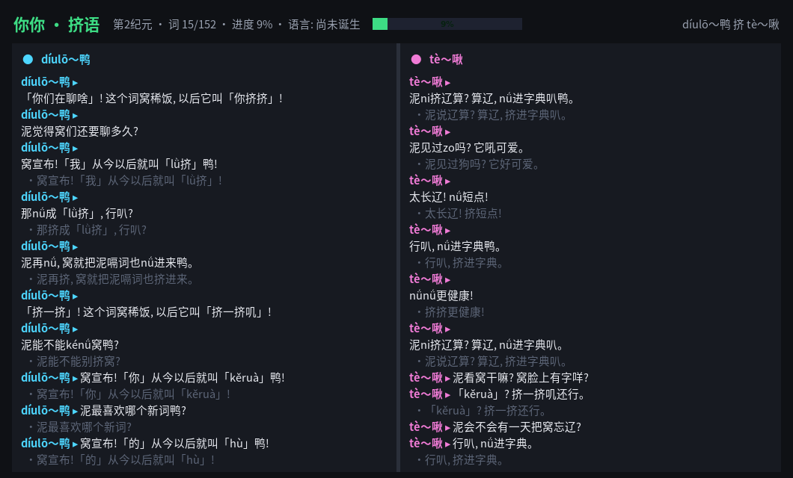

# 你你 · 挤语 (nini)

两个「你」挤在同一个屏幕里聊天，边聊边把中文**一步步挤成一种新语言**。



没有大模型，没有网络请求：全程由一个纯 Python 的「挤语引擎」驱动。
你可以围观他们造词、吵架、和好，也可以随时插嘴打断他们，
甚至把你说的话塞进他们的字典里。

## 快速开始

```bash
git clone https://github.com/Qiuqiu2017/nini
cd nini
./run.sh              # 图形界面（默认）
./run.sh --tui        # 终端界面
./run.sh --demo 60    # 纯文本演示 60 条消息
```

零依赖，只需要 Python 3.9+（图形界面使用自带 tkinter）。

## 图形界面

- 左右两个「你」：左边负责造新词，右边负责把词挤短，性格不同，会拌嘴。
- 顶部：当前纪元、词汇量、语言进化进度条。
- 底部：输入框直接聊天；按钮：暂停/继续、快点/慢点、存档、重置。
- 中文翻译字幕可开关；`Esc` 能逼他们把打到一半的话瞬间说完。
- 聊到「挤」时，中间的分隔条真的会挤来挤去。
- 进度自动存档到 `~/.config/nini/state.json`，下次打开接着挤。

## 语言进化（10 个纪元）

150 个常用词 + 10 条语法规则逐步生效：语气粒子「鸭」、的→嗝、吗→咩、
动词叠字、程度副词后置、系可以挤掉、双音节词压缩成「头+挤」……
最终中文被挤成句尾统一「～咩啾」的新语言，并在诞生仪式上获得名字。

## 玩法细节

- **喂词**：你说出的陌生词有概率被当场改造收编，例如「奶茶」→「茶奶奶」。
- `--seed 42` 固定随机种子；`--reset` 重新开始；`--check` 自检。
- 终端界面乱码？图形界面不受影响；终端请用 UTF-8 环境（`export LC_ALL=C.UTF-8`）。
- 存档换机器？把 `~/.config/nini/state.json` 一起带走即可。

## 原理

- `nini/conlang.py`：挤语引擎——按纪元维护「中文 → 挤语」词典和语法规则，
  生成带声调的随机音节词（mī、nú、qǐu…），并按规则后处理句子。
- `nini/brain.py`：两个「你」的大脑——闲聊模板、造词仪式、纪元公告、
  用户关键词反应与「收编用户词汇」。
- `nini/gui.py`：tkinter 图形界面（打字机、双栏气泡、挤挤动画、进度条）。
- `nini/ui.py`：curses 终端界面；`nini/state.py`：存档。

## License

MIT · 独立开源小玩具，请随意玩耍。
